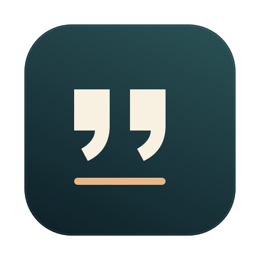
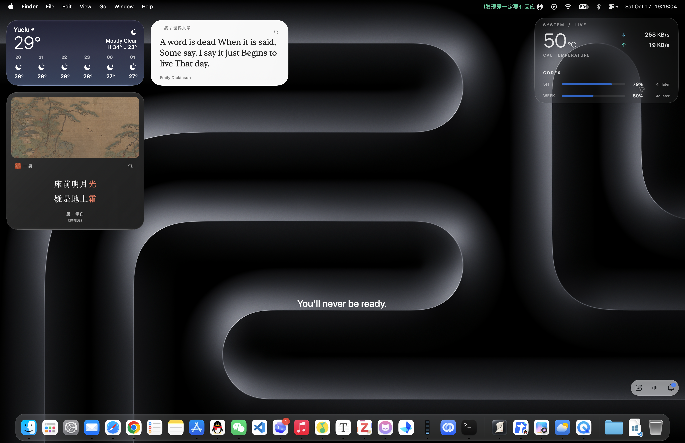

<p align="center"></p>
<h1 align="center">DesktopLine</h1>
<p align="center"><strong>A quiet place for one sentence.</strong></p>
<p align="center">Native macOS desktop text. Transparent. Borderless. Click-through.</p>
<p align="center"><a href="https://github.com/weekwu/DesktopLine/releases/latest">Download</a> · <a href="README.md">中文</a> · <a href="CONTRIBUTING.md">Contribute</a></p>



The white sentence near the lower center is DesktopLine. The weather, poetry
and system-monitoring cards belong to separate desktop tools.

## One line, with room to make it yours

- A transparent native AppKit window with no title bar, background, outline or window shadow.
- Normal application windows cover the text. Locking passes mouse events through to the desktop; unlocking lets you drag it.
- Menu-bar preferences for text, font size and weight, color, opacity, wrapping and display placement.
- Five named position presets. A preset restores placement and typography while keeping the current sentence and color.
- Full-screen coordinate anchors unaffected by Dock visibility, with one-physical-pixel adjustment steppers.
- Local settings, no network requests, telemetry, third-party runtime or periodic polling.

## Install

Download the Apple Silicon archive from [Releases](https://github.com/weekwu/DesktopLine/releases/latest),
unzip it and move **桌面一句.app** to **Applications**. Open it and look for the
quotation-mark icon in the menu bar. The app does not add a Dock icon or enable
launch at login automatically.

The download targets **macOS 14+ / Apple Silicon**. Runtime validation was on
macOS 27.0.1; older systems and Intel hardware have not been runtime-tested.
The package is ad-hoc signed and has **not** been notarized by Apple. Building
locally is also supported.

## Use

Open preferences from the menu bar. The first tab edits the sentence and its
appearance; the second edits its position and saved slots. Unlock to drag, then
choose **完成并锁定** to finish and restore click-through. Closing preferences
also locks the overlay. Changes are saved immediately.

Slot 1 starts with a lock-screen reference; slot 2 preserves the previous layout
at initialization; slots 3–5 are empty. All slots can be renamed and overwritten.
A saved slot includes position, font size and weight, wrapping width and display.
On a 2× Retina display, a stepper movement of 0.5 points is one physical pixel.

The lock-screen preset is derived from the standard authenticated macOS 27.0.1
layout. It is a reference for a single short line, not a pixel-perfect guarantee
across operating systems, display scaling, authentication states or multiline
content. See [the alignment notes](docs/lock-screen-alignment.md).

## About the demo sentence

The sentence in the screenshot is an excerpt from **Tim Cook's address at
Stanford's 128th Commencement, June 16, 2019**. In the closing section, Cook
reflects on assuming responsibility after Steve Jobs's death and the distinction
between preparation and feeling ready. The Chinese README includes the short
original passage and its context.

Primary source: [Stanford Report, official prepared address](https://news.stanford.edu/stories/2019/06/remarks-tim-cook-2019-stanford-commencement).

## Build and check

Use Xcode or Command Line Tools already installed on a Mac. No additional packages
are required.

```sh
git clone https://github.com/weekwu/DesktopLine.git
cd DesktopLine
zsh build.sh
./桌面一句.app/Contents/MacOS/DesktopLine --self-test
```

The build targets macOS 14 on the host architecture. Set `DESKTOPLINE_ARCH` to
`arm64` or `x86_64` for another slice. Temporary compilation caches and icon
intermediates are removed on exit. There are 42 self checks; passing them does
not replace real multi-display or lock-screen visual testing.

## Local data and removal

Preferences live in `~/Library/Application Support/DesktopLine/settings.json`.
Initialization can reuse an existing system lock-screen message when the demo
sentence has not been customized. The app never transmits it. No Accessibility,
Screen Recording or Full Disk Access permission is required.

Quit the app and move it to Trash to uninstall. Keep the settings directory to
preserve your sentence and presets; remove it and the app's own preference domain
for a clean reset. Remove any login item you added yourself.

## License

Code and original icon artwork: [MIT](LICENSE). The screenshot was supplied by
the project author; third-party interfaces, wallpaper, marks and quoted material
retain their respective rights. See [CONTRIBUTING.md](CONTRIBUTING.md) and
[CHANGELOG.md](CHANGELOG.md).
